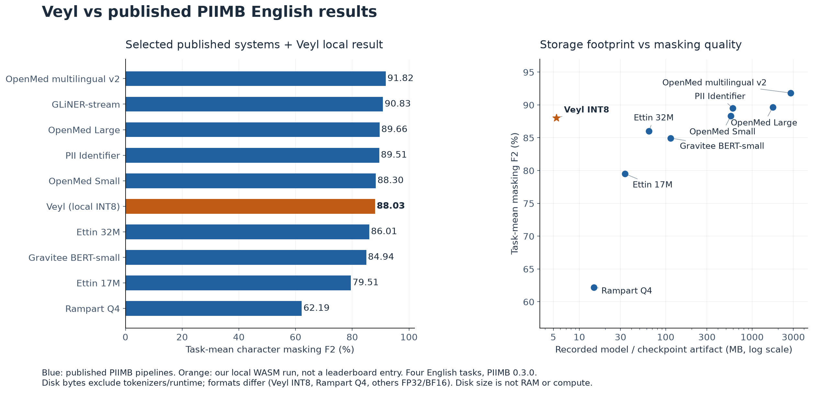

# Evaluation

Run commands from the Veyl root. INT8 scores use the [pinned bundle](../weights/sha.json), ONNX Runtime Web 1.30.0 and one WASM thread.

## Scores

| Measurement | Result |
| --- | ---: |
| PIIMB English mean masking F2 | 88.03% |
| Mean task precision / recall | 78.04% / 91.50% |
| Pooled precision / recall | 84.25% / 95.38% |
| Real-120 masking F2 | 93.75% |
| TAB pooled masking F2 | 67.84% |
| RedactionBench mandatory-policy F2 | 68.56% |

Metrics compare character-mask coverage. `F2 = 5PR / (4P + R)` weights recall more than precision. PIIMB averages four task scores without weighting. Pooled metrics aggregate character counts.

| Dataset | Evaluation scope |
| --- | --- |
| PIIMB | 121,409 English rows selected from 150,022 source rows |
| Real-120 | 120 authored examples |
| TAB | 127 documents repeated across 555 annotator rows |
| RedactionBench | 200 rows; mandatory policy excludes contextual-only regions from precision penalties |

These are local results, not an official leaderboard submission. Dataset policies differ; TAB rows are not independent samples.

## Reproduce scores

```sh
uv run --locked python eval/score.py --check
uv run --locked python eval/score.py piimb
uv run --locked python eval/score.py real
uv run --locked python eval/score.py tab
uv run --locked python eval/score.py redaction
```

Supply the Git-ignored `data/eval/` inputs and `local/predictions/` files with sibling `.meta.json` records. The scorer checks hashes, model pins, counts, row order, IDs and tasks. It writes `runs/score/<dataset>.json` without running inference. An optional second argument selects another prediction file.

## FP32 benchmark

Use the PyTorch environment from [Kaggle setup](train.md#kaggle-setup).

```sh
python -m eval.model
python -m eval.bench --check
python -m eval.bench
```

`eval.model` checks weights, gradients, gates and tokenizer fixtures. `eval.bench --check` tests decoding without PyTorch. Full benchmarking needs the local archive and checkpoints. It uses batch 64 and CUDA when available, otherwise CPU. `--device` and `--batch-size` override those defaults. The output directory `runs/bench/fp32/` must not exist.

| Runtime | Mean F2 | Mean precision | Mean recall |
| --- | ---: | ---: | ---: |
| FP32 PyTorch | 88.06% | 78.03% | 91.53% |
| INT8 WASM | 88.03% | 78.04% | 91.50% |

The FP32 run used a Tesla T4 and PyTorch 2.11.0, with TF32 and autocast disabled. Both paths scored identical rows. Their F2 difference includes tokenizer and runtime effects; it does not isolate quantization loss.

## Comparisons



The [CSV](../results/chart/table.csv) contains VEYL and 35 published model results from the [pinned PIIMB snapshot](https://huggingface.co/datasets/piimb/pii-masking-benchmark-results/tree/e0a5b75aa26adcf2476617b0a2b415b098ea64b9/results). Precision formats, labels and decoders differ. Artifact size does not measure RAM or compute. Rampart's benchmark pipeline omits companion recognizers.

```sh
uv run --locked --extra plot python eval/chart.py
```

Chart regeneration needs ignored `local/reports/` and `local/comparisons/`. It writes public images and the CSV to `results/chart/`, and JSON audits to `local/reports/chart/`.

## Performance and limits

Chrome 152 on a Ryzen 3 3200G measured median inference at 4.2 ms for 29 pieces and 80.9 ms for 510 pieces. These times exclude debounce, regex and rendering. Downloads include 5.43 MB ONNX, 0.71 MB tokenizer/labels and 14.24 MB WASM.

Privy precision, recall and F2 are 46.20%, 76.26% and 67.48%. Known errors include Infosys as PERSON, Aadhaar as EMAIL, ordinary quantities and mixed-script boundaries. Native CPU and WASM differ on nine argmax values across 15 fixtures. Other runtimes need separate evaluation.

Synthetic data, source-family overlap and developer inspection limit benchmark independence. Smoke checks do not establish production accuracy.
